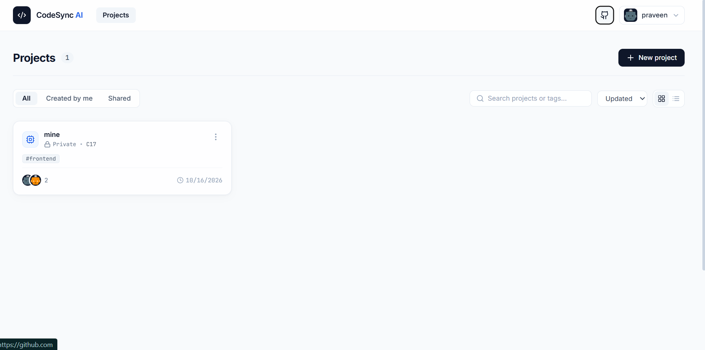
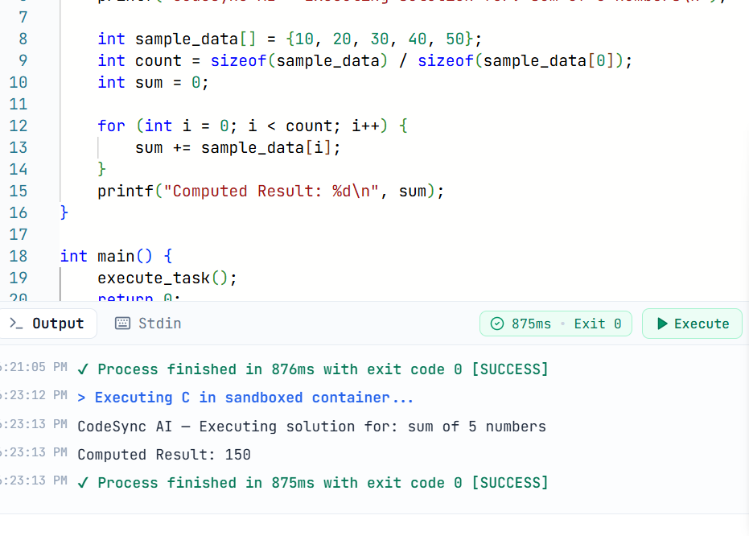
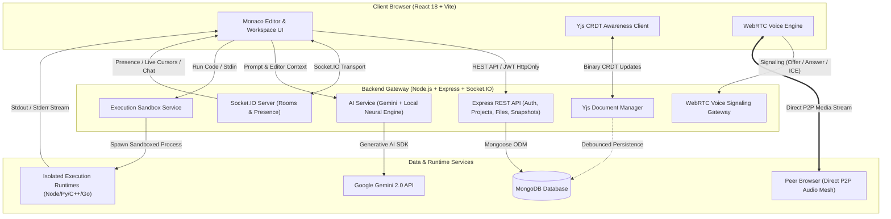

# CodeSync AI

> AI-powered real-time collaborative cloud IDE with Monaco Editor, Yjs CRDT, WebRTC voice, secure code execution, AI pair programming, and version snapshots.

[](https://react.dev/)
[](https://www.typescriptlang.org/)
[](https://nodejs.org/)
[](https://www.mongodb.com/)
[](https://vitest.dev/)
[](https://opensource.org/licenses/MIT)

CodeSync AI is a full-stack, browser-based cloud development platform designed to streamline software engineering teamwork. It combines a VS Code-grade in-browser editor, Google Docs-style real-time collaboration with conflict-free editing, integrated team chat and peer-to-peer voice channels, context-aware AI pair programming, and a multi-language sandboxed code execution engine—all wrapped in a clean, high-performance web interface.

---

## Screenshots

> *UI previews and workflow captures across key platform views:*

| View | Preview |
| :--- | :--- |
| **Landing Page** |  |
| **Dashboard** |  |
| **Workspace IDE** |  |
| **Real-Time Collaboration** |  |
| **AI Pair Assistant** |  |
| **Code Execution Engine** |  |

---

## Key Features

- **Monaco-based cloud IDE**: Full-featured in-browser code editor with multi-language syntax highlighting, tabbed file navigation, keyboard shortcuts, and intelligent indentation.
- **Yjs CRDT real-time collaborative editing**: Sub-millisecond concurrent editing powered by Conflict-free Replicated Data Types (CRDTs) over WebSockets, ensuring seamless convergence without merge conflicts.
- **Live cursors and collaborator presence**: Real-time cursor coordinates, text selections, user color tags, and active file indicators across all connected workspace members.
- **Workspace team chat**: In-project messaging with syntax-highlighted code snippet references and one-click jump-to-file capabilities.
- **WebRTC peer-to-peer voice**: Low-latency, full-mesh audio channels with real-time speaking detection, audio visualizer wave animation, and mute/deafen controls.
- **Secure code execution**: Multi-language runtime execution engine (Node.js, Python 3, C++, Go) with configurable CPU timeouts, memory boundaries, and standard I/O streaming.
- **Gemini-powered AI pair programming**: Context-aware AI coding assistant providing code explanations, bug fixing, refactoring, test generation, and Bring-Your-Own-Key (BYOK) support.
- **Virtual file system**: Hierarchical file and directory management with language detection, auto-save mechanisms, and starter templates (React, Node.js, Python, C++, Go, Blank).
- **Project/member management**: Project creation, categorization tags, customizable visibility, and role-based access control (Owner, Editor, Viewer).
- **Snapshots and one-click rollback**: Point-in-time state capture with snapshot history audit trails and one-click codebase rollbacks.
- **JWT HttpOnly cookie authentication**: Dual-token architecture with short-lived access JWTs, tamper-proof HttpOnly refresh cookies, and bcrypt password hashing.
- **Light premium glass UI**: Modern, accessible interface featuring glassmorphic panels, responsive layouts, subtle depth gradients, and custom scrollbars.

---

## Architecture



---

## Tech Stack

| Domain | Technologies |
| :--- | :--- |
| **Frontend** | React 18, TypeScript, Vite, Monaco Editor (`@monaco-editor/react`), Zustand, Tailwind CSS, Lucide Icons, Framer Motion |
| **Backend** | Node.js (20+), Express.js, TypeScript, Socket.IO, Yjs (`y-protocols`), Zod, Helmet, Cookie-Parser, BcryptJS, JWT |
| **Real-Time & Media** | Yjs CRDT, Socket.IO (WebSocket & Polling transports), WebRTC (RTCPeerConnection audio mesh) |
| **Database** | MongoDB, Mongoose ODM |
| **AI Integration** | Google Gen AI SDK (`@google/genai` / Gemini 2.0), Custom Heuristic Algorithmic & Master Theorem Engine |
| **Code Execution** | Isolated child-process runner with timeout management, environment cleansing, resource limits; Docker-ready |
| **Testing** | Vitest, Supertest, In-memory MongoDB runner |
| **DevOps & Infrastructure** | Docker, Multi-Stage Dockerfiles, Docker Compose, Nginx Reverse Proxy |

---

## Real-Time Collaboration

CodeSync AI achieves reliable, sub-millisecond concurrent editing through **Conflict-free Replicated Data Types (CRDTs)**:
- **Yjs CRDT Document Synchronization**: Document changes are modeled as operational CRDT updates rather than centralized locks. Simultaneous edits from multiple developers automatically converge into a deterministic final state without merge conflicts.
- **Socket.IO Transport**: Binary-encoded Yjs updates are broadcast over Socket.IO rooms to all connected peers and persisted to MongoDB via debounced write flushes to minimize database overhead.
- **Awareness & Presence**: Remote cursor positions (line, column), text selections, and user profile badges are tracked via the awareness protocol and rendered directly into Monaco Editor with distinct user colors.

---

## AI Assistant

The AI pair programmer is embedded directly in the workspace side drawer:
- **Google Gemini Integration**: Connected via the Google Gen AI SDK for code analysis, contextual reasoning, and test generation.
- **Bring-Your-Own-Key (BYOK) Support**: Developers can provide their own Gemini API key directly from the workspace header modal. The key is stored locally in the client session without persisting to backend databases.
- **Core Capabilities**:
  - **Explain**: Dissects code logic, algorithmic steps, and time/space complexity.
  - **Fix Bugs**: Identifies syntax errors, runtime exceptions, and edge-case bugs with recommended fixes.
  - **Refactor**: Modernizes code structure, improves readability, and optimizes performance.
  - **Generate Tests**: Scaffolds comprehensive unit tests for functions and classes.
- **Fallback CS/Algorithm Engine**: When an API key is not configured, a zero-setup local neural engine provides instant algorithm analysis, Big-O complexity estimation, and Master Theorem recursion analysis out of the box.

---

## Secure Code Execution

The execution engine enables in-browser testing and validation of written code:
- **Supported Runtimes**: Node.js (JavaScript / TypeScript), Python 3, C++ (GCC / Clang), and Go.
- **Sandboxing & Resource Limits**:
  - Execution timeout enforcement (configurable, defaulting to 10 seconds) with automated process termination (`SIGKILL`) to prevent infinite loops.
  - Memory caps (defaulting to 256MB) to protect against memory exhaustion.
  - Environment variable cleansing to prevent accidental leakage of host secrets.
  - Isolated working directories with automatic cleanup after process completion.
- **Security Scope**: The built-in process runner enforces process isolation, execution timeouts, and environment cleansing. For untrusted public code execution, deployment inside containerized Docker or gVisor sandboxes is recommended.

---

## Testing

The codebase includes an automated test suite verifying data models, REST endpoints, authentication rules, CRDT synchronization, and frontend state management.

```
Test Files  11 passed (11)
     Tests  87 passed (87)
  Duration  ~22s
```

- **Backend**: **71 tests** across 9 test suites (`auth`, `project`, `file`, `crdt`, `chat`, `execution`, `ai`, `snapshot`, `cors`).
- **Frontend**: **16 tests** across 2 test suites (`stores`, `network`).
- **Type Safety**: Full monorepo TypeScript compilation checks pass with zero errors (`npm run build`).

---

## Local Development

### Prerequisites
- **Node.js**: v20.0.0 or higher
- **npm**: v10.0.0 or higher
- **MongoDB**: Local MongoDB instance or MongoDB Atlas cluster connection string

### Setup & Installation

```bash
# 1. Clone the repository
git clone https://github.com/praveenprasanthearle/CodeSyncAI.git
cd CodeSyncAI

# 2. Install monorepo dependencies
npm install

# 3. Configure backend environment variables
cp backend/.env.example backend/.env
# Edit backend/.env to set your JWT secrets and MongoDB URI

# 4. (Optional) Configure frontend environment variables
cp frontend/.env.example frontend/.env

# 5. Start both servers concurrently
npm run dev
```

- **Frontend Application**: `http://localhost:5173`
- **Backend API & WebSockets**: `http://localhost:5000`

---

## LAN Collaboration Testing

CodeSync AI supports multi-device local network testing so multiple laptops on the same Wi-Fi can collaborate in real time without cloud deployment:

1. Run the dev server on your host machine:
   ```bash
   npm run dev
   ```
2. Find your host laptop's local IPv4 address:
   - **Windows**: Run `ipconfig` and find the IPv4 Address under `Wireless LAN adapter Wi-Fi`.
   - **macOS / Linux**: Run `ifconfig` or `ip a`.
3. Other devices on the same Wi-Fi network open:
   ```text
   http://HOST_LAN_IP:5173
   ```

*The frontend dynamically derives the backend gateway host and port (`5000`) directly from the browser hostname, allowing REST requests and Socket.IO connections to function without hard-coded IPs.*

> [!NOTE]
> Modern Chromium browsers (Chrome, Edge) restrict microphone access (`getUserMedia`) to secure contexts (`localhost` or `https://`). When testing voice rooms over plain LAN HTTP, add `http://HOST_LAN_IP:5173` to `chrome://flags/#unsafely-treat-insecure-origin-as-secure` on the client laptop, or deploy behind HTTPS. Real-time text collaboration, live cursors, chat, and code execution work out of the box over plain HTTP.

---

## Environment Variables

### Backend (`backend/.env`)

| Variable | Description |
| :--- | :--- |
| `PORT` | Backend server port (default: `5000`) |
| `HOST` | Network interface binding (default: `0.0.0.0` for LAN access) |
| `NODE_ENV` | Environment mode (`development`, `production`, `test`) |
| `CLIENT_URL` | Allowed client origin in production (e.g., `http://localhost:5173`) |
| `DATABASE_URL` | MongoDB connection URI |
| `JWT_ACCESS_SECRET` | Secret key for signing short-lived access tokens (min. 16 characters) |
| `JWT_REFRESH_SECRET` | Secret key for signing refresh tokens (min. 16 characters) |
| `JWT_ACCESS_EXPIRES_IN` | Access token lifespan (e.g., `15m` or `7d`) |
| `JWT_REFRESH_EXPIRES_IN` | Refresh token lifespan (e.g., `7d` or `30d`) |
| `COOKIE_SECRET` | Secret key used for signing session cookies |
| `GEMINI_API_KEY` | *(Optional)* Google Gemini API key for AI assistant features |
| `OPENAI_API_KEY` | *(Optional)* OpenAI API key |
| `DOCKER_HOST` | *(Optional)* Docker daemon socket/host URI for container execution |
| `SANDBOX_TIMEOUT_MS` | Max execution time per process in milliseconds (default: `10000`) |
| `SANDBOX_MAX_MEMORY_MB` | Max memory limit per execution in megabytes (default: `256`) |

### Frontend (`frontend/.env` — Optional)

| Variable | Description |
| :--- | :--- |
| `VITE_API_URL` | Explicit backend REST API base URL (overrides auto-detection) |
| `VITE_SOCKET_URL` | Explicit Socket.IO server URL (overrides auto-detection) |
| `VITE_WS_URL` | Alternative WebSocket URL override |
| `VITE_BACKEND_PORT` | Custom backend port for local LAN auto-derivation (default: `5000`) |

---

## Repository Structure

```
CodeSyncAI/
├── backend/                         # Express.js + TypeScript Backend Service
│   ├── src/
│   │   ├── config/                  # Database, environment, and CORS configurations
│   │   ├── controllers/             # REST API route handlers
│   │   ├── middleware/              # Auth, RBAC, rate-limiting, and error middleware
│   │   ├── models/                  # Mongoose data schemas (User, Project, FileNode, Snapshot, Chat)
│   │   ├── routes/                  # Express API route declarations
│   │   ├── services/                # Business logic (AI, Auth, Execution, File, Project, Snapshot)
│   │   ├── sockets/                 # Socket.IO handlers, Yjs CRDT manager, and WebRTC gateway
│   │   ├── tests/                   # Vitest automated integration test suites
│   │   ├── utils/                   # JWT helpers, cookie management, response wrappers
│   │   ├── validations/             # Zod input validation schemas
│   │   ├── app.ts                   # Express application setup
│   │   └── server.ts                # Server entry point & graceful shutdown
│   ├── Dockerfile                   # Multi-stage production container build
│   └── tsconfig.json                # TypeScript backend compiler configuration
├── frontend/                        # React 18 + Vite Frontend Application
│   ├── src/
│   │   ├── api/                     # Centralized Axios client & token refresh interceptors
│   │   ├── components/
│   │   │   ├── dashboard/           # Project creation, settings, and member modals
│   │   │   ├── layout/              # Navbar, Footer, and theme shells
│   │   │   └── workspace/           # Monaco Editor, FileTree, Chat, Voice, Terminal, Snapshots
│   │   ├── pages/                   # Landing, Login, Register, Dashboard, Workspace pages
│   │   ├── stores/                  # Zustand state stores (Auth, File, Collab, Voice, AI, Exec)
│   │   ├── tests/                   # Vitest frontend unit & store tests
│   │   ├── types/                   # TypeScript domain interface definitions
│   │   ├── utils/                   # Monaco decorations, network resolver, helpers
│   │   ├── App.tsx                  # Root router & route guards
│   │   ├── index.css                # Tailwind directives & glassmorphic styling
│   │   └── main.tsx                 # React DOM mount
│   ├── nginx.conf                   # Production Nginx reverse proxy configuration
│   ├── Dockerfile                   # Multi-stage frontend container build
│   ├── tailwind.config.js           # Theme palette & layout tokens
│   └── vite.config.ts               # Vite configuration with LAN host binding & dev proxies
├── docs/                            # Architectural blueprints, API documentation, task tracking
├── docker-compose.yml               # Container orchestration for backend, frontend & MongoDB
└── package.json                     # Monorepo workspace orchestration
```

---

## Production Deployment

Production deployment requires the following infrastructure components:

- **HTTPS Frontend**: Production Vite build artifacts served via Nginx or a static CDN with HTTP/2 enabled.
- **Node.js / Express Backend**: Deployed on Node.js 20+ with process supervision (e.g., PM2, Kubernetes, or container orchestration).
- **Socket.IO & WebSockets**: Reverse proxy configured with WebSocket upgrade headers (`Upgrade $http_upgrade`, `Connection "Upgrade"`).
- **MongoDB**: Managed MongoDB Atlas cluster or hardened replica set.
- **Security Policies**: Production CORS restricted to `CLIENT_URL` with credentials allowed, and cookies configured with `secure: true` and `sameSite: 'strict'`.
- **Isolated Execution Runtimes**: Docker daemon access or an isolated microVM sandbox (e.g., Firecracker / gVisor) for executing untrusted user code.

*Live Demo: **Coming soon***

---

## Roadmap

- [ ] **GitHub OAuth & Repository Sync**: Direct repository importing and branch synchronization with GitHub.
- [ ] **Split Editor Layouts**: Side-by-side split panes for concurrent multi-file viewing.
- [ ] **Interactive Terminal (PTY)**: Full pseudo-terminal support via xterm.js and node-pty for interactive CLI processes.
- [ ] **Scalable WebRTC SFU Architecture**: Migration from full-mesh WebRTC to an SFU (e.g., LiveKit / mediasoup) for high-occupancy voice channels.
- [ ] **Extension Marketplace**: In-editor extension support for custom themes, linters, and language servers.

---

## Author

**E. Praveen Prasanth**  
GitHub: [@praveenprasanthearle](https://github.com/praveenprasanthearle)

---

## License

This project is licensed under the [MIT License](https://opensource.org/licenses/MIT).
